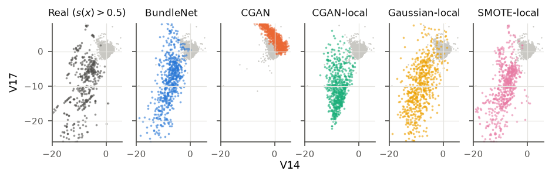

# Exploring the Fibers of Fraud

Code and results for the article

> Brady Ali. *Exploring the Fibers of Fraud: Bundle Networks for Generating and Analyzing Fraudulent Transactions.* 2026.

This repository contains everything needed to reproduce the results of the article: data preparation, the
implementation of Bundle Networks and of all baseline models, the training and evaluation scripts, and the scripts
that generate every table and figure from the saved results.

## Overview

A fraud detection model is a many-to-one map: it assigns a single risk score to a large and heterogeneous set of
transactions. The set of all transactions that the model maps to the same score is called a *fiber* of the model.
The article studies these fibers with Bundle Networks (BundleNets), a generative architecture introduced by
Courts and Kvinge (ICLR 2022) that models the fibers of a machine learning task through the local trivializations of
a fiber bundle.

In short, a BundleNet divides the base space (here, the scores of the fraud model) into neighborhoods and trains an
invertible neural network that maps every transaction `x` to a pair `(y, z)`, where `y` is its base point and `z` a
fiber coordinate describing all remaining variation. Run in reverse, the network turns a chosen base point `y` and a
sampled `z` into a new transaction lying over `y`.

The experiments use the public credit card fraud dataset of the Université Libre de Bruxelles (284,807 real
transactions, 492 frauds) with a chronological split: the first 80% of the transactions are used for training and the
last 20% for testing. Two base spaces are considered: the out-of-fold score of an XGBoost fraud detection model
(25 neighborhoods) and the class label (2 neighborhoods).

A self-contained introduction to BundleNets, with a small example that trains in a few minutes, is given in
[`notebooks/understanding_bundlenets.ipynb`](notebooks/understanding_bundlenets.ipynb).



*Real high-risk transactions (left) and transactions generated by each model over high-risk base points, in the plane
of two features (Figure 3 of the article).*

## Repository structure

```
.
├── README.md
├── requirements.txt            exact package versions used for the article
├── run_all.sh                  runs the complete pipeline
├── data/
│   └── README.md               how to obtain creditcard.csv (not redistributed)
├── src/
│   ├── data.py                 chronological split, standardization, out-of-fold XGBoost score
│   ├── bundlenet.py            Bundle Network: architecture, training objective, sampling, likelihood
│   ├── baselines.py            CGAN, CGAN-local, WGAN, Gaussian-local, SMOTE-local, real-data reference
│   ├── metrics.py              Wasserstein distances, k-NN KL divergence, MSMD, MMD, bootstrap intervals
│   ├── models.py               model registry and configuration
│   ├── train_all.py            trains all models for one base space
│   ├── eval_generation.py      global and fiberwise data generation, base-point error
│   ├── eval_augmentation.py    generated fraud as training data, paired bootstrap
│   ├── eval_classification.py  classification by likelihood ratio and tabular baselines
│   ├── fiber_analysis.py       fiber profiles, counterfactuals, base-point error figure
│   ├── explanatory_figures.py  fibers on real data, real and generated high-risk transactions
│   └── make_tables.py          writes every table of the article as LaTeX
├── notebooks/
│   ├── understanding_bundlenets.ipynb   introduction to BundleNets with a small example
│   └── colab_reference_size.ipynb       reruns all experiments at the reference network size on a GPU
└── results/
    ├── *.csv                   raw and summarized results of every experiment
    ├── figures/                figures of the article (PDF and PNG)
    └── tables/                 tables of the article (LaTeX)
```

## Installation

The code was run with Python 3.14 on Windows 11, on a laptop CPU (Intel Core i7-1265U, 10 cores, 32 GB of memory).
No GPU is required.

```
git clone https://github.com/Bra-AM/bundlenet_frauddetection.git
cd bundlenet_frauddetection
pip install -r requirements.txt
```

`requirements.txt` lists the exact versions used to produce the results. The main dependencies are PyTorch, FrEIA
(invertible network layers), geomloss (Wasserstein distances), XGBoost, LightGBM, scikit-learn and imbalanced-learn.

## Data

Download `creditcard.csv` from the Kaggle page of the dataset,
<https://www.kaggle.com/datasets/mlg-ulb/creditcardfraud>, and place it at `data/creditcard.csv`.
The preparation script verifies the file by its SHA-256 checksum. Details are given in
[`data/README.md`](data/README.md).

## Reproducing the results

The complete pipeline is run with

```
bash run_all.sh
```

It takes about nine hours on the CPU described above; nearly all of this time is spent training the models.
The individual steps, all run from the `src/` directory, are the following.

| Step | Command | Output |
|---|---|---|
| 1. Prepare the data | `python data.py` | Chronological split and out-of-fold scores, cached in `cache/` |
| 2. Train, model score as base space | `python train_all.py score 0 1 2` | BundleNet, CGAN, CGAN-local and WGAN, three seeds each |
| 3. Train, class label as base space | `MODELS=BundleNet,CGAN,CGAN-local python train_all.py class 0 1 2` | BundleNet, CGAN and CGAN-local, three seeds each |
| 4. Data generation, model score | `python eval_generation.py score 0 1 2` | Tables 1 and 2 |
| 5. Data generation, class label | `python eval_generation.py class 0 1 2` | Table 3 |
| 6. Generated fraud as training data | `python eval_augmentation.py` | Table 4 and the significance table of the appendix |
| 7. Classification | `python eval_classification.py` | Table 5 |
| 8. Fiber analysis | `python fiber_analysis.py` | Figures 4 to 7 |
| 9. Explanatory figures | `python explanatory_figures.py` | Figures 1 and 3 |
| 10. Tables | `python make_tables.py` | `results/tables/*.tex` |

Figure 2 of the article (the architecture diagram) is drawn directly in LaTeX.

Trained models are saved in `cache/models/` and are skipped if they already exist, so an interrupted run can be
resumed by running the same command again. The trained models are not stored in this repository because of their
size; steps 2 and 3 recreate them.

Steps 4 to 10 can be checked without retraining: the directory `results/` contains the outputs of every experiment
as produced for the article, and `python make_tables.py` regenerates all tables from them.

### Determinism

All random seeds are fixed. Data preparation is deterministic: on the same file it reproduces the split and the
out-of-fold scores exactly. Training and evaluation use seeded generators, so results obtained with the package
versions of `requirements.txt` should agree with the reported ones up to small numerical differences between
platforms; all reported quantities are means over three trained models with 95% confidence intervals.

### Configuration

The configuration used for the article is the default. The size of the BundleNet can be changed with environment
variables, without editing the code:

| Variable | Default | Meaning |
|---|---|---|
| `BN_WIDTH` | 256 | width of the coupling sub-networks |
| `BN_DEPTH` | 3 | depth of the coupling sub-networks |
| `BN_EPOCHS` | 300 | training epochs (doubled when the class label is the base space) |
| `BN_LR` | 5e-4 | initial learning rate |
| `GAN_STEPS` | 7500 | training steps of the GAN baselines |
| `THREADS` | 10 | CPU threads used by PyTorch |

The original BundleNet paper uses sub-networks of width 512 and depth 5. The notebook
[`notebooks/colab_reference_size.ipynb`](notebooks/colab_reference_size.ipynb) reruns all experiments at that size on
a GPU; training runs on a GPU automatically when one is available.

## Main results

All numbers are computed on the test set, which contains only transactions that occur after the training period.
Lower is better for the Wasserstein-1 distance and the base-point error.

| | BundleNet | CGAN | CGAN-local | Gaussian-local | SMOTE-local |
|---|---|---|---|---|---|
| Wasserstein-1 distance, fibers over high-risk base points | **12.4** | 15.0 | 15.7 | 18.3 | 15.8 |
| Base-point error, high-risk base points (logit) | 1.78 | 6.00 | 4.24 | 2.45 | **1.23** |
| Share of generated fraud flagged by the fraud model (real fraud: 0.70) | 0.71 | 0.96 | 0.95 | 0.78 | n/a |

Adding 2,000 fraudulent transactions generated by BundleNet to the training set raises the AUPRC of an XGBoost fraud
detector from 0.800 to 0.814, whereas SMOTE with the same number of samples leaves it unchanged (0.798). As a
classifier, a BundleNet scored by likelihood ratio reaches an AUPRC of 0.757 and does not outperform gradient boosting
(0.800). The complete tables, with confidence intervals, are in `results/tables/`.

## Implementation notes

`src/bundlenet.py` follows the reference implementation of Courts and Kvinge
(<https://github.com/NicoCourts/bundle-networks>): neighborhoods obtained by k-means, an affine layer conditioned on
the neighborhood followed by RealNVP coupling blocks and permutations, a forward loss on the base point, and a backward
loss made of two k-nearest-neighbor KL-divergence estimates and a distance term, with weights 10, 1, 1, 1.
The differences, made to handle a dataset of this size, are the following.

- The KL and distance terms are computed from a single matrix of pairwise distances instead of loops over points.
  The values are the same; distances are computed exactly, because approximate self-distances that are not exactly
  zero would be mistaken for nearest neighbors by the estimator.
- Each neighborhood is subsampled to 256 transactions per training step.
- Gradient norms are clipped at 10.

The conditional baselines are trained on batches drawn in the same way as for BundleNet (a neighborhood uniformly at
random, then a transaction within it) and with the same number of training examples. The dataset contains exactly
duplicated transactions; generated transactions are compared with unique test transactions only, because the
k-nearest-neighbor estimators are undefined for a reference set made of copies of a single point.

## Citation

If you use this code, please cite the article and the original BundleNet paper.

```
@article{ali2026fibers,
  title  = {Exploring the Fibers of Fraud: Bundle Networks for Generating and Analyzing Fraudulent Transactions},
  author = {Ali, Brady},
  year   = {2026}
}

@inproceedings{courts2022bundle,
  title     = {Bundle Networks: Fiber Bundles, Local Trivializations, and a Generative Approach to Exploring Many-to-one Maps},
  author    = {Courts, Nico and Kvinge, Henry},
  booktitle = {International Conference on Learning Representations},
  year      = {2022}
}
```

## Acknowledgments

The BundleNet architecture and the GAN baseline architectures follow the reference repository of Courts and Kvinge.
Invertible layers are provided by FrEIA, and Wasserstein distances by geomloss. The dataset was collected and made
public by Worldline and the Machine Learning Group of the Université Libre de Bruxelles.

## Contact

Brady Ali, balimedi@uwaterloo.ca
